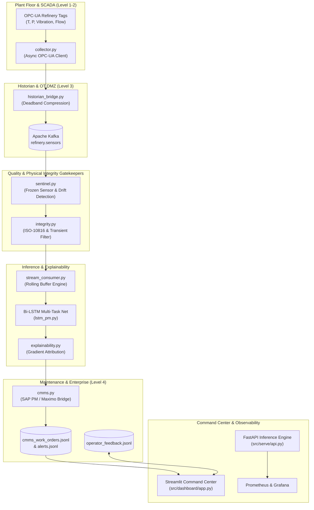

# Refinery Predictive Maintenance Engine (Industry 4.0) - Enterprise Edition v2.0

## 📌 Executive Summary
A complete, industrial-grade **Predictive Maintenance (PM) Engine** engineered specifically for continuous petrochemical refinery operations (Crude Distillation Units, Wet Gas Compressors, and Heavy Oil Pumps).

In addition to deep learning inference, this platform addresses every critical real-world operational requirement identified by plant reliability engineers, MLOps architects, and SCADA automation specialists:
1. **Physical Integrity & Standards:** Embedded **ISO 10816-3 machinery vibration classification** (Zones A–D) and an **Operational Regime Transient Detector** to suppress nuisance false alarms during crude slate switches or plant startups.
2. **Industrial Sensor Sentinel:** Automated detection of flatlined/frozen sensor channels and distribution drift before data enters the model.
3. **Purdue Model Level 3 Historian Bridge:** Simulates OSIsoft PI / Aspen InfoPlus.21 connections with **deadband and exception compression** to conserve OT network bandwidth.
4. **Deep Learning & Multi-task Core:** Pure PyTorch Bi-directional LSTM yielding joint failure probability (**97.55% validation accuracy**) and hourly Remaining Useful Life (RUL).
5. **AI Explainability & Root-Cause Attribution:** Gradient-based attribution pinpointing specific physical sensor contributions for operators.
6. **Automated CMMS Integration (SAP PM / IBM Maximo):** Automatic generation of formatted SAP Notification Type M2 maintenance work orders containing required warehouse spare parts, LOTO isolation procedures, and **financial downtime exposure calculations**.
7. **Human-in-the-Loop Operator Feedback:** Direct feedback loop allowing operators to confirm or dismiss alarms, building ground truth for active learning.
8. **Operations & Observability:** Real-time FastAPI scoring service, Prometheus metrics, and an interactive **Streamlit Command Center UI**.

---

## 🏗️ Enterprise Architecture (v2.0)



---

## 📂 Project Directory Structure

Located at: `C:\Users\VICTUS\.gemini\antigravity\scratch\refinery-pm`

```
refinery-pm/
├── docker-compose.yml              # Kafka, Zookeeper, Prometheus, Grafana, Collector
├── requirements.txt                # Python dependencies
├── README.md                       # Complete documentation & runbook
├── monitoring/
│   └── prometheus.yml              # Prometheus scraper config for PM API
├── checkpoints/
│   ├── best_refinery_pm.pt         # Trained Bi-LSTM checkpoint (Val Acc: 97.55%)
│   └── feature_scaler.json         # Feature mean and standard deviation dictionary
├── data/
│   ├── raw/
│   │   ├── sensors/                # refinery_sensors.parquet (259k telemetry rows)
│   │   └── maintenance_logs/       # work_orders.parquet
│   ├── processed/
│   │   ├── features.parquet        # 86,394 engineered feature rows (48 cols)
│   │   └── failure_label.parquet   # 7-day failure horizon labels + RUL hours
│   ├── alerts.jsonl                # Real-time alert journal generated by stream consumer
│   ├── cmms_work_orders.jsonl      # Dispatched SAP PM / IBM Maximo work orders
│   └── operator_feedback.jsonl     # Operator true/false alarm validation journal
├── src/
│   ├── ingest/
│   │   ├── collector.py            # Edge OPC-UA client -> Kafka producer
│   │   ├── historian_bridge.py     # OSIsoft PI deadband exception compression
│   │   ├── Dockerfile              # Container spec for collector
│   │   └── generate_mock_data.py   # Refinery dataset generator
│   ├── features/
│   │   └── build_features.py       # Rolling moments and spectral energy pipeline
│   ├── model/
│   │   ├── lstm_pm.py              # Pure PyTorch Bi-LSTM multi-task network
│   │   ├── trainer.py              # Chronological sequence training script
│   │   ├── explainability.py       # Sensor attribution & root-cause analysis
│   │   ├── sentinel.py             # Data quality & frozen sensor gatekeeper
│   │   ├── integrity.py            # ISO-10816 vibration bands & transient filter
│   │   └── cmms.py                 # SAP PM work order dispatch & financial risk
│   ├── serve/
│   │   ├── api.py                  # Real-time scoring API + Prometheus metrics
│   │   └── stream_consumer.py      # Rolling buffer and live alert trigger
│   ├── dashboard/
│   │   └── app.py                  # Streamlit operator dashboard v2.0
│   ├── verify_model.py             # Model smoke-test script
│   ├── run_pipeline_demo.py        # Pipeline validation test
│   └── run_enterprise_validation.py # Complete v2.0 multi-agent system test
└── notebooks/
    └── 01_feature_engineering.ipynb # Interactive exploration and visualization
```

---

## 🚀 How to Run & Verify

### 1. Execute the Enterprise Validation Suite
Validates the entire pipeline end-to-end (Data lakes, Sentinel, ISO-10816, Bi-LSTM, Explainability, CMMS dispatch, and Operator Feedback):
```powershell
cd C:\Users\VICTUS\.gemini\antigravity\scratch\refinery-pm
python src\run_enterprise_validation.py
```

### 2. Launch the Operator Command Center (Streamlit)
```powershell
streamlit run src\dashboard\app.py
```
- **Live Degradation Curves:** Multi-channel sensor trends and ISO-10816 vibration zone indicators.
- **Financial Exposure:** Real-time downtime risk calculation ($ at risk).
- **SAP PM Work Order Manager:** View automatically dispatched maintenance tickets and required warehouse spares.
- **Human Feedback Form:** Submit operator findings directly to the active learning journal.

### 3. Launch the Real-Time Inference API
```powershell
python src\serve\api.py
```
- Swagger Docs: `http://localhost:8000/docs`
- Prometheus Metrics: `http://localhost:8000/metrics`

### 4. Distributed Infrastructure Stack
```powershell
docker compose up -d
```
- Grafana: `http://localhost:3000` (`admin` / `admin`)
- Prometheus: `http://localhost:9090`
